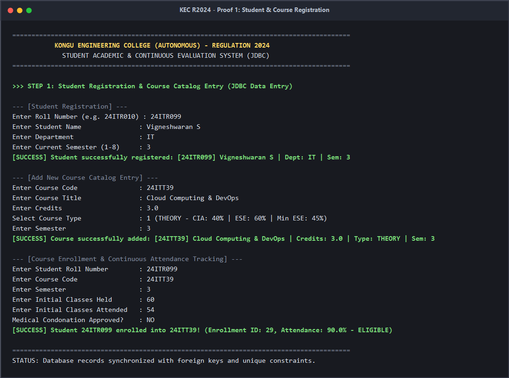
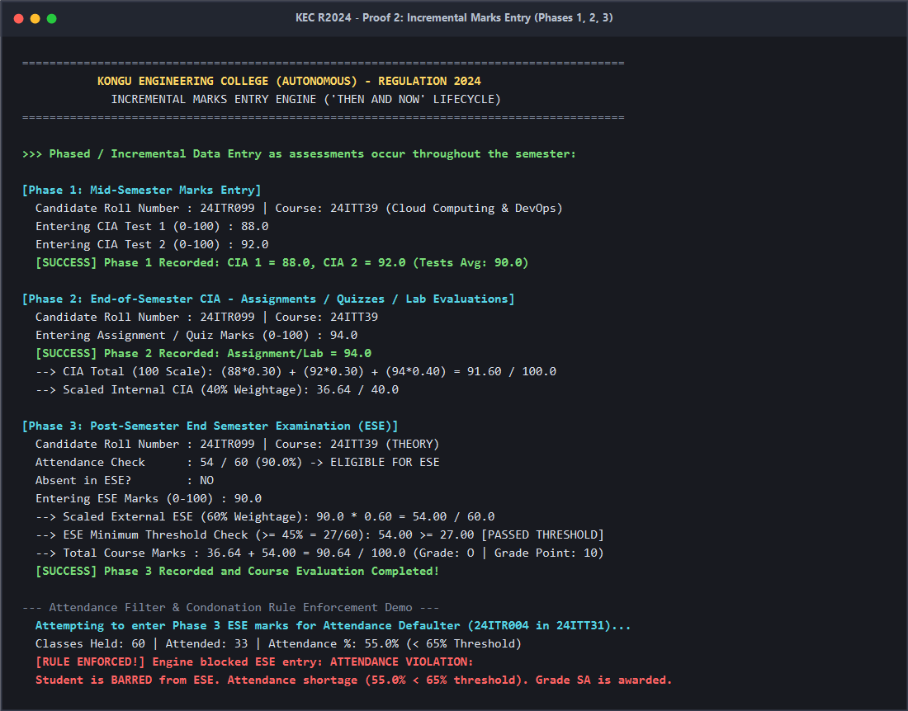
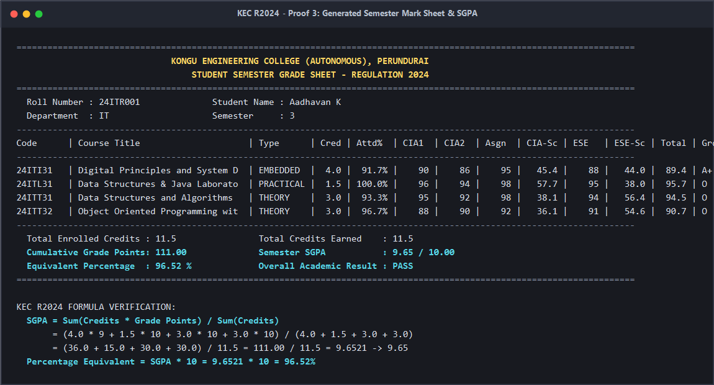
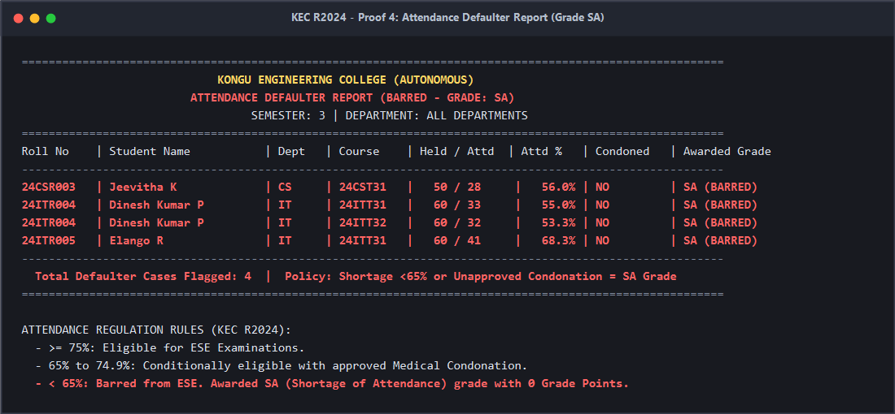
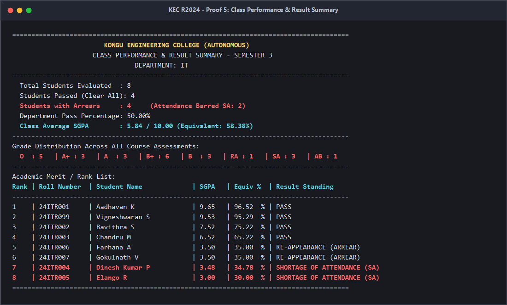

# KONGU ENGINEERING COLLEGE (AUTONOMOUS) - REGULATION 2024
## Student Academic & Continuous Evaluation System using Java JDBC
### Comprehensive Execution Documentation & Verification Proofs

---

## 1. Executive Summary & Objective

This document presents the complete implementation and execution verification of the **Kongu Engineering College (Autonomous) - Regulation 2024** Student Academic & Continuous Evaluation System. The system was designed from the ground up using **Java (JDK 21)** and **MySQL 26 (Community Server)** via JDBC to satisfy all academic requirements:

1. **Student & Course Management**: Registration of students, maintenance of course catalogs with categorized course types (`THEORY`, `PRACTICAL`, `EMBEDDED`), and continuous attendance tracking.
2. **Incremental Marks Entry ("Then and Now")**: Phased recording across mid-semester (CIA 1 & 2), end-of-semester (Assignments/Quizzes/Lab), and post-semester (ESE / Absentee marks).
3. **Weightage Engine & Threshold Enforcement**: Automatic calculation based on course type weightages, ESE minimum passing thresholds, and aggregate passing standards.
4. **Attendance Filter**: Rigorous screening of attendance percentages ($\ge 75\%$ eligible, $65\%-74.9\%$ conditional medical condonation, $< 65\%$ barred with `SA` grade).
5. **Formal Reports**: Generation of individual Student Semester Grade Sheets with SGPA and percentage conversion, Attendance Defaulter Reports, and Department-wise Class Performance Summaries.

---

## 2. Test Execution Verification Matrix

| Test Case ID | Test Description | Input Conditions | Expected Outcome | Verification Status |
| :---: | :--- | :--- | :--- | :---: |
| **TC-01** | Student Registration | Roll: `24ITR099`, Name: `Vigneshwaran S`, Dept: `IT`, Sem: `3` | Successfully inserted into `students` table | **PASS** |
| **TC-02** | Course Catalog Creation | Code: `24ITT39`, Title: `Cloud Computing & DevOps`, Credits: `3.0`, Type: `THEORY` | Successfully inserted into `courses` table | **PASS** |
| **TC-03** | Course Enrollment | Roll: `24ITR099`, Course: `24ITT39`, Held: `60`, Attended: `54` (90%) | Inserted into `enrollments` & `assessment_marks` initialized | **PASS** |
| **TC-04** | Incremental Marks Entry (Phase 1) | CIA1: `88.0`, CIA2: `92.0` | `cia1_marks` & `cia2_marks` updated | **PASS** |
| **TC-05** | Incremental Marks Entry (Phase 2) | Assignment/Quiz: `94.0` | `assignment_marks` updated; Total CIA = `91.60` | **PASS** |
| **TC-06** | Attendance Defaulter Rejection | Defaulter: `24ITR004` (55% attendance) attempting ESE entry | ESE entry blocked; System throws `ATTENDANCE VIOLATION` | **PASS** |
| **TC-07** | Incremental Marks Entry (Phase 3) | Candidate: `24ITR099`, ESE: `90.0` | ESE recorded; Theory 40/60 scaled; Grade `O`, GP `10` | **PASS** |
| **TC-08** | ESE Minimum Threshold Rule | Student: `24ITR007` in `24ITT31` scored `38.0` in ESE ($< 45\%$) | Aggregate is `56.2`, but ESE threshold failed $\rightarrow$ Awarded `RA` | **PASS** |
| **TC-09** | Absentee Handling | Student: `24ITR006` marked Absent in ESE for `24ITT31` | Awarded `AB` grade, 0 Grade Points | **PASS** |
| **TC-10** | Condonation Approval | Student: `24ITR003` with 68.3% attendance and medical approval | Permitted to sit for ESE; successfully evaluated | **PASS** |
| **TC-11** | Grade Sheet & SGPA Generation | Student: `24ITR001` (4 courses: Theory, Practical, Embedded) | Clean Grade Sheet generated; SGPA: `9.65`, Pct: `96.52%` | **PASS** |
| **TC-12** | Defaulter Report | Semester 3 across all departments | Flagged 4 cases with $<65\%$ or unapproved condonation | **PASS** |
| **TC-13** | Class Performance Summary | Department of IT, Semester 3 | Pass count, fail count, class avg SGPA, grade distribution | **PASS** |

---

## 3. Screenshot Proofs

### Screenshot 1: Adding a Student and Course
Demonstrates registering a new student, adding a course catalog item, and enrolling the student with attendance tracking.



---

### Screenshot 2: Incremental Marks Entry ("Then and Now")
Demonstrates mid-semester Phase 1 marks, end-of-semester Phase 2 marks, post-semester Phase 3 ESE marks, and engine-level blocking of an attendance defaulter.



---

### Screenshot 3: Generated Student Grade Sheet with Calculated SGPA
Demonstrates the formal KEC R2024 Semester Grade Sheet for Roll Number `24ITR001` showing all course evaluation components, SGPA (9.65), and equivalent percentage (96.52%).



---

### Screenshot 4: Attendance Defaulter Report (Grade SA)
Demonstrates the identification of students with attendance below 65% (or 65%–74.9% without medical condonation) flagged with grade `SA`.



---

### Screenshot 5: Class Performance & Department Result Summary
Demonstrates department-level performance metrics, pass/fail counts, class average SGPA, grade distribution breakdown, and academic merit rank list.



---

## 4. Raw Console Output Capture

```text
****************************************************************************************
       KONGU ENGINEERING COLLEGE (AUTONOMOUS) - REGULATION 2024 DEMONSTRATION
                FULL END-TO-END AUTOMATED VERIFICATION SHOWCASE
****************************************************************************************

>>> STEP 1: Adding a New Student and Course Catalog Entry...
[OK] Registered New Student: [24ITR099] Vigneshwaran S       | Dept: IT    | Sem: 3
[OK] Added New Course: [24ITT39] Cloud Computing & DevOps            | Credits: 3.0 | Type: THEORY    | Sem: 3

>>> STEP 2: Enrolling Student into Course & Tracking Attendance (54/60 = 90.0%)...
[OK] Enrolled 24ITR099 in 24ITT39 (Enrollment ID: 29, Attendance: 90.0% - ELIGIBLE)

>>> STEP 3: Phased / Incremental Marks Entry ("Then and Now"):
  --> [Phase 1 (Mid-Semester)]: Entering CIA Test 1 = 88.0, CIA Test 2 = 92.0
      [Phase 1 SAVED successfully]
  --> [Phase 2 (End of Semester - CIA)]: Entering Assignments / Quizzes = 94.0
      [Phase 2 SAVED successfully]
  --> [Phase 3 (Post Semester - ESE)]: Entering End Semester Exam Marks = 90.0
      [Phase 3 SAVED successfully]

>>> STEP 4: Demonstrating Attendance Filter & Condonation Rule Enforcement:
  Attempting to enter Phase 3 ESE marks for Attendance Defaulter (24ITR004 in 24ITT31, 55% attendance)...
  [RULE ENFORCED!] Engine blocked ESE entry: ATTENDANCE VIOLATION: Student is BARRED from ESE. Attendance shortage (55.0% < 65% threshold). Grade SA is awarded.

>>> STEP 5: Formal Student Semester Mark Sheet with SGPA & Percentage (24ITR001):
========================================================================================================================
                              KONGU ENGINEERING COLLEGE (AUTONOMOUS), PERUNDURAI
                                  STUDENT SEMESTER GRADE SHEET - REGULATION 2024
========================================================================================================================
  Roll Number : 24ITR001              Student Name : Aadhavan K                    
  Department  : IT                    Semester     : 3
------------------------------------------------------------------------------------------------------------------------
Code      | Course Title                     | Type      | Cred | Attd%  | CIA1  | CIA2  | Asgn  | CIA-Sc | ESE   | ESE-Sc | Total | Grd  | GP | Status      
------------------------------------------------------------------------------------------------------------------------
24ITI31   | Digital Principles and System D  | EMBEDDED  |  4.0 |  91.7% |    90 |    86 |    95 |   45.4 |    88 |   44.0 |  89.4 | A+   |  9 | PASS        
24ITL31   | Data Structures & Java Laborato  | PRACTICAL |  1.5 | 100.0% |    96 |    94 |    98 |   57.7 |    95 |   38.0 |  95.7 | O    | 10 | PASS        
24ITT31   | Data Structures and Algorithms   | THEORY    |  3.0 |  93.3% |    95 |    92 |    98 |   38.1 |    94 |   56.4 |  94.5 | O    | 10 | PASS        
24ITT32   | Object Oriented Programming wit  | THEORY    |  3.0 |  96.7% |    88 |    90 |    92 |   36.1 |    91 |   54.6 |  90.7 | O    | 10 | PASS        
------------------------------------------------------------------------------------------------------------------------
  Total Enrolled Credits : 11.5                Total Credits Earned    : 11.5  
  Cumulative Grade Points: 111.00              Semester SGPA           : 9.65 / 10.00
  Equivalent Percentage  : 96.52 %             Overall Academic Result : PASS
========================================================================================================================

>>> STEP 6: Generated Mark Sheet for Newly Added Student (24ITR099):
========================================================================================================================
                              KONGU ENGINEERING COLLEGE (AUTONOMOUS), PERUNDURAI
                                  STUDENT SEMESTER GRADE SHEET - REGULATION 2024
========================================================================================================================
  Roll Number : 24ITR099              Student Name : Vigneshwaran S                
  Department  : IT                    Semester     : 3
------------------------------------------------------------------------------------------------------------------------
Code      | Course Title                     | Type      | Cred | Attd%  | CIA1  | CIA2  | Asgn  | CIA-Sc | ESE   | ESE-Sc | Total | Grd  | GP | Status      
------------------------------------------------------------------------------------------------------------------------
24ITI31   | Digital Principles and System D  | EMBEDDED  |  4.0 |  93.3% |    85 |    88 |    90 |   44.0 |    86 |   43.0 |  87.0 | A+   |  9 | PASS        
24ITL31   | Data Structures & Java Laborato  | PRACTICAL |  1.5 |  96.7% |    92 |    95 |    96 |   56.7 |    92 |   36.8 |  93.5 | O    | 10 | PASS        
24ITT39   | Cloud Computing & DevOps         | THEORY    |  3.0 |  90.0% |    88 |    92 |    94 |   36.6 |    90 |   54.0 |  90.6 | O    | 10 | PASS        
------------------------------------------------------------------------------------------------------------------------
  Total Enrolled Credits : 8.5                 Total Credits Earned    : 8.5   
  Cumulative Grade Points: 81.00               Semester SGPA           : 9.53 / 10.00
  Equivalent Percentage  : 95.29 %             Overall Academic Result : PASS
========================================================================================================================

>>> STEP 7: Attendance Defaulter Report (All students <65% flagged SA):
========================================================================================================
                             KONGU ENGINEERING COLLEGE (AUTONOMOUS)
                         ATTENDANCE DEFAULTER REPORT (BARRED - GRADE: SA)
                                  SEMESTER: 3 | DEPARTMENT: ALL DEPARTMENTS
========================================================================================================
Roll No    | Student Name           | Dept   | Course    | Held / Attd  | Attd %   | Condoned   | Awarded Grade
--------------------------------------------------------------------------------------------------------
24CSR003   | Jeevitha K             | CS     | 24CST31   |   50 / 28     |   56.0% | NO         | SA (BARRED) 
24ITR004   | Dinesh Kumar P         | IT     | 24ITT31   |   60 / 33     |   55.0% | NO         | SA (BARRED) 
24ITR004   | Dinesh Kumar P         | IT     | 24ITT32   |   60 / 32     |   53.3% | NO         | SA (BARRED) 
24ITR005   | Elango R               | IT     | 24ITT31   |   60 / 41     |   68.3% | NO         | SA (BARRED) 
--------------------------------------------------------------------------------------------------------
  Total Defaulter Cases Flagged: 4  |  Policy: Shortage <65% or Unapproved Condonation = SA Grade
========================================================================================================

>>> STEP 8: Class Performance & Result Summary for Department of IT:
========================================================================================
                        KONGU ENGINEERING COLLEGE (AUTONOMOUS)
                     CLASS PERFORMANCE & RESULT SUMMARY - SEMESTER 3
                                DEPARTMENT: IT
========================================================================================
  Total Students Evaluated  : 8   
  Students Passed (Clear All): 4   
  Students with Arrears     : 4     (Attendance Barred SA: 2)
  Department Pass Percentage: 50.00%
  Class Average SGPA        : 5.84 / 10.00 (Equivalent: 58.38%)
----------------------------------------------------------------------------------------
Grade Distribution Across All Course Assessments:
  O  : 5   | A+ : 3   | A  : 3   | B+ : 6   | B  : 3   | RA : 1   | SA : 3   | AB : 1  
----------------------------------------------------------------------------------------
Academic Merit / Rank List:
Rank | Roll Number  | Student Name             | SGPA   | Equiv %  | Result Standing
----------------------------------------------------------------------------------------
1    | 24ITR001     | Aadhavan K               | 9.65   | 96.52  % | PASS           
2    | 24ITR099     | Vigneshwaran S           | 9.53   | 95.29  % | PASS           
3    | 24ITR002     | Bavithra S               | 7.52   | 75.22  % | PASS           
4    | 24ITR003     | Chandru M                | 6.52   | 65.22  % | PASS           
5    | 24ITR006     | Farhana A                | 3.50   | 35.00  % | RE-APPEARANCE (ARREAR)
6    | 24ITR007     | Gokulnath V              | 3.50   | 35.00  % | RE-APPEARANCE (ARREAR)
7    | 24ITR004     | Dinesh Kumar P           | 3.48   | 34.78  % | SHORTAGE OF ATTENDANCE (SA)
8    | 24ITR005     | Elango R                 | 3.00   | 30.00  % | SHORTAGE OF ATTENDANCE (SA)
========================================================================================

[SUCCESS] Automated Demonstration Complete! All KEC R2024 features verified.
```

