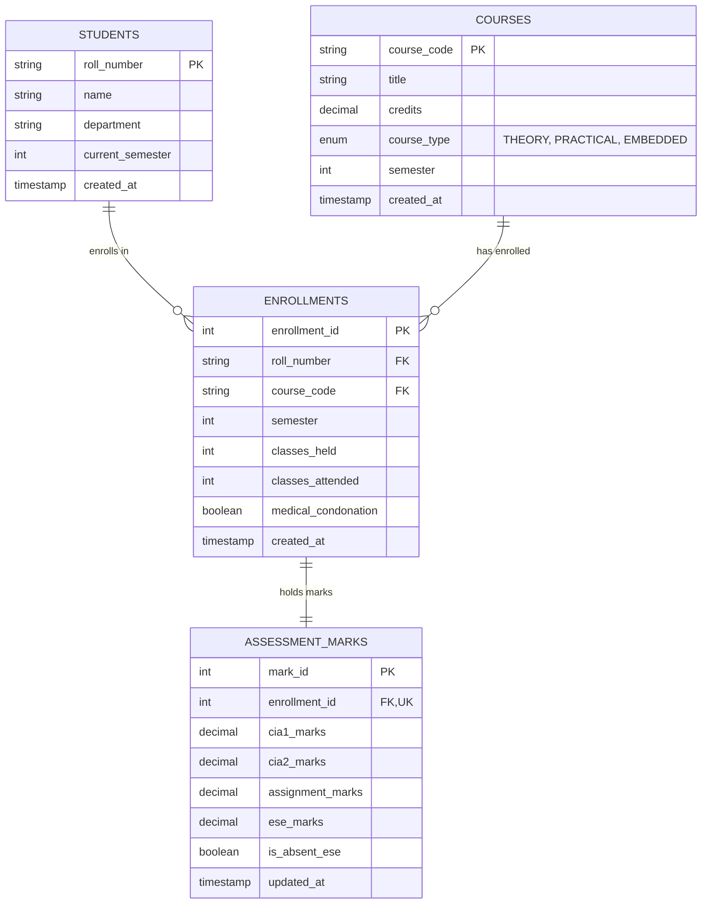

# Kongu Engineering College (Autonomous) - Regulation 2024
## Student Academic & Continuous Evaluation System using Java JDBC

An enterprise-grade, database-driven Java application built with JDBC to manage student records, perform incremental marks entry (Continuous Internal Assessments and End Semester Examinations), enforce strict attendance eligibility rules, and generate formal academic performance reports according to **Kongu Engineering College (Autonomous) - Regulation 2024**.

---

## 1. System Architecture & Requirements Coverage

| Requirement Module | Implementation Details |
| :--- | :--- |
| **Database Connection** | [`DBConnection.java`](file:///C:/Users/VETRI%20VEL%20MURUGAN/Desktop/KECEval/DBConnection.java) handles MySQL connection pooling, dynamic configuration, and validation tests. |
| **Student & Course Management** | [`StudentDAO.java`](file:///C:/Users/VETRI%20VEL%20MURUGAN/Desktop/KECEval/StudentDAO.java) performs CRUD for students, course catalog (`THEORY`, `PRACTICAL`, `EMBEDDED`), and semester enrollments. |
| **Continuous Attendance Tracking** | Enforces >= 75% for eligibility; 65%–74.9% requires Medical Condonation; < 65% awards `SA` grade and bars student from ESE. |
| **Incremental Marks Entry** | [`AcademicDAO.java`](file:///C:/Users/VETRI%20VEL%20MURUGAN/Desktop/KECEval/AcademicDAO.java) implements 3-phase incremental updates: **Phase 1** (CIA 1 & 2), **Phase 2** (Assignments/Lab), and **Phase 3** (ESE & Absentee tracking). |
| **KEC R2024 Weightage Engine** | Theory (40/60, Min 45%), Practical (60/40, Min 50%), Embedded (50/50, Min 45%), Aggregate Min 50. |
| **10-Point Grading & SGPA** | 10-point scale (`O`, `A+`, `A`, `B+`, `B`, `RA`, `SA`, `AB`), exact SGPA and percentage conversion ($SGPA \times 10$). |
| **Formal Reports** | 1) Student Semester Grade Sheet, 2) Attendance Defaulter Report (`SA`), 3) Class Performance & Result Summary. |

---

## 2. Database Schema (`kec_schema.sql`)

The database consists of 4 normalized relational tables enforced with primary keys, foreign keys, cascade triggers, and check constraints:



---

## 3. KEC R2024 Evaluation Rules & Weightage Engine

### 3.1 Course Categories & Evaluation Parameters

| Course Type | CIA Weightage | ESE Weightage | ESE Minimum Threshold | Overall Pass Minimum |
| :--- | :---: | :---: | :---: | :---: |
| **THEORY** | 40% | 60% | **45% (27.0 / 60)** | **50 Marks** |
| **PRACTICAL** | 60% | 40% | **50% (20.0 / 40)** | **50 Marks** |
| **EMBEDDED** | 50% | 50% | **45% (22.5 / 50)** | **50 Marks** |

* **Total CIA Formula (100 Scale)**:
  $$\text{CIA}_{100} = (\text{CIA}_1 \times 0.30) + (\text{CIA}_2 \times 0.30) + (\text{Assignment/Lab} \times 0.40)$$
* **Scaled Total Course Marks**:
  $$\text{Total Course Marks} = (\text{CIA}_{100} \times W_{\text{CIA}}) + (\text{ESE} \times W_{\text{ESE}})$$

### 3.2 Attendance Eligibility Rules

$$\text{Attendance \%} = \frac{\text{Classes Attended}}{\text{Classes Held}} \times 100$$

* **$\ge 75\%$**: Eligible to appear for End Semester Examinations.
* **$65\% \text{ to } 74.9\%$**: Conditionally eligible only if formal **Medical Condonation** is approved.
* **$< 65\%$**: Barred from appearing in ESE. Awarded **SA (Shortage of Attendance)** grade with 0 Grade Points.

### 3.3 10-Point Letter Grading Scale

| Raw / Scaled Total Marks | Letter Grade | Grade Point | Performance Classification |
| :---: | :---: | :---: | :--- |
| **91 – 100** | **O** | 10 | Outstanding |
| **81 – 90** | **A+** | 9 | Excellent |
| **71 – 80** | **A** | 8 | Very Good |
| **61 – 70** | **B+** | 7 | Good |
| **50 – 60** | **B** | 6 | Above Average |
| **< 50 or Failed ESE Min** | **RA** | 0 | Re-Appearance / Fail |
| **Shortage of Attendance** | **SA** | 0 | Barred from Exam |
| **Absent in ESE** | **AB** | 0 | Absent |

### 3.4 SGPA & Percentage Formulas

$$\text{SGPA} = \frac{\sum (\text{Course Credits} \times \text{Grade Points Earned})}{\sum \text{Total Enrolled Credits}}$$

$$\text{Equivalent Percentage} = \text{SGPA} \times 10$$

---

## 4. Incremental Marks Entry ("Then and Now")

The system mirrors the actual collegiate academic lifecycle:
* **Phase 1 (Mid-Semester)**: Evaluates and records internal assessments (CIA Test 1 and CIA Test 2).
* **Phase 2 (End of Semester - CIA)**: Records continuous evaluation components (Assignments, Quizzes, Lab records) and consolidates scaled internal marks.
* **Phase 3 (Post Semester)**: Enforces attendance validation before permitting entry of End Semester Examination (ESE) marks or registering absence (`AB`). Barred students (`SA`) are blocked from ESE entry.

---

## 5. Project Directory Structure

```
C:\Users\VETRI VEL MURUGAN\Desktop\KECEval\
├── mysql-connector-j-8.4.0.jar         # MySQL JDBC Type-4 Connector
├── kec_schema.sql                      # DDL & DML Script with R2024 Seed Data
├── DBConnection.java                   # JDBC Connection Manager
├── CourseType.java                     # Theory / Practical / Embedded Enum with weights
├── Student.java                        # Student Domain Entity
├── Course.java                         # Course Domain Entity
├── Enrollment.java                     # Enrollment & Attendance Entity
├── AssessmentMarks.java                # Phased Incremental Marks Entity
├── CourseEvaluationResult.java         # R2024 Evaluation Engine
├── StudentMarkSheet.java               # Mark Sheet, SGPA & Percentage Entity
├── StudentDAO.java                     # Student, Course & Enrollment DAO
├── AcademicDAO.java                    # Evaluation Engine, Phased Entry & Analytics DAO
├── MainApp.java                        # Menu-Driven Console Application & Automated Showcase
├── compile.bat / compile.ps1           # Build scripts
├── run.bat / run.ps1                   # Interactive Application Launchers
├── run_demo.bat                        # Automated Verification Showcase
├── render_screenshots.ps1              # High-res Screenshot Generation Script
├── EXECUTION_DOCUMENTATION.md          # Comprehensive Execution Proofs Report
└── docs/
    └── screenshots/                    # PNG Screen Proofs
        ├── screenshot_1_add_student_course.png
        ├── screenshot_2_incremental_marks_entry.png
        ├── screenshot_3_grade_sheet_sgpa.png
        ├── screenshot_4_attendance_defaulters.png
        └── screenshot_5_class_performance_summary.png
```

---

## 6. How to Compile and Run

### 6.1 Database Setup
Ensure MySQL is running on port 3306 with password `0000`. Import the schema:
```powershell
Get-Content kec_schema.sql -Raw | mysql -u root -p0000
```

### 6.2 Compilation
```powershell
javac -cp ".;mysql-connector-j-8.4.0.jar" *.java
```
Or execute `compile.bat` / `./compile.ps1`.

### 6.3 Running Interactive Menu
```powershell
java -cp ".;mysql-connector-j-8.4.0.jar" MainApp
```
Or execute `run.bat` / `./run.ps1`.

### 6.4 Running Automated Verification Showcase
```powershell
java -cp ".;mysql-connector-j-8.4.0.jar" MainApp --demo
```
Or execute `run_demo.bat`.

---

## 7. Execution Proofs & Screenshots

### Proof 1: Adding a Student & Course Catalog Entry


### Proof 2: Incremental Marks Entry ("Then and Now" Lifecycle)


### Proof 3: Generated Student Semester Mark Sheet with SGPA & Percentage


### Proof 4: Attendance Defaulter Report (Grade SA)


### Proof 5: Class Performance & Department Result Summary


